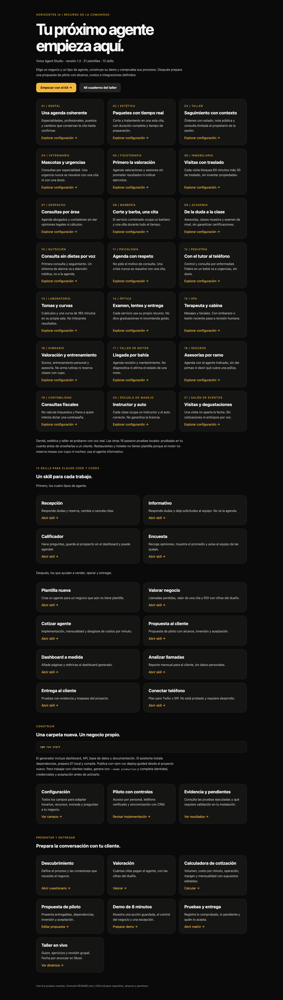

# Horizontes Voice Agent Studio

Construye una demo de recepcionista con IA para un negocio, comprueba sus procesos y prepara una propuesta de implementación. Kit de Horizontes IA, versión 1.3.



## Instálalo con una frase

Abre Claude Code o Codex y pégale esto:

```text
Clona https://github.com/Horizontes-IA/voice-agent-studio en mi carpeta Documentos, instala sus 12 skills y dime qué hago primero.
```

Tu IA hace el resto. El chat normal de ChatGPT o de Claude no puede instalar nada en tu computadora: necesitas Claude Code o Codex.

**Si eres una IA instalando esto para alguien, sigue [AGENTS.md](AGENTS.md).**

[INICIO.html](INICIO.html) es el mapa de recursos: enlaza la calculadora, plantillas, taller y documentos de entrega. Puedes abrirlo directamente en tu navegador.

## Tu primer proyecto

Necesitas Node.js 22.22+, npm y, para publicar voz, tus propias cuentas de Cloudflare y ElevenLabs. El kit no tiene costo; los proveedores facturan el consumo de tu cuenta.

```sh
npm run start
```

El asistente pregunta el negocio y la carpeta, instala dependencias, prepara D1 local y compila. También puedes generar sin instalar:

```sh
node tools/create-project.mjs --preset dental --out ../mi-clinica
node tools/create-project.mjs --preset inmobiliaria --out ../mi-inmobiliaria
node tools/create-project.mjs --preset veterinaria --out ../mi-veterinaria
```

Escoge un negocio y una carpeta nueva. La lista completa está en [21 negocios](#21-negocios). Dentro del proyecto generado:

```sh
npm ci
npm run setup
npm run db:local
npm run build
npm run preview
```

Entra a http://127.0.0.1:8787 con la contraseña de `.secrets/admin-password.txt`. En otra terminal ejecuta `npm test`. El README generado explica despliegue, secretos, publicación en ElevenLabs y pruebas de navegador. No necesitas conectar voz para explorar la UI local.

## Hazlo tuyo

1. Copia un JSON de `presets/` a un archivo propio.
2. Completa nombre, catálogo, equipo, horarios y conocimiento con información aprobada. Si tu negocio no tiene plantilla, escribe sus reglas en `agent.sectorPolicy`: si no, heredará las de la plantilla que copiaste.
3. Genera con `node tools/create-project.mjs --config ./mi-negocio.json --out ../mi-demo`.
4. Prueba y registra resultados en `implementation-report.json` del proyecto.

El JSON se aplica al generar. Editarlo luego no actualiza la UI compilada ni una DB existente. Genera otra carpeta para una nueva configuración. El motor admite de 1 a 20 recursos, horarios por día incluidos domingos, turnos partidos, cierres por fecha, zonas IANA y moneda ISO. El catálogo puede limitar qué recursos usa un servicio. Horizonte, intervalo entre opciones y plazo de cambios son configurables. Consulta [los campos y ejemplo](skills/voice-agent-studio/references/configuration.md). Un paquete de estética usa una especialista y puesto durante toda la cita.

## Publicar y comprobar tu instalación

Dentro del proyecto generado, autentica tu cuenta con `npx wrangler login` y ejecuta `npm run deploy:guided`. El asistente crea una D1 propia, aplica migraciones, despliega HTTPS y sube secretos. Rechaza nombres ocupados; conserva el progreso privado para continuar después de una interrupción. Conecta ElevenLabs desde el dashboard, elige una voz y publica. Cada cuenta tiene su propio consumo.

Para automatizar la publicación, configura `ELEVENLABS_API_KEY` y `ELEVENLABS_VOICE_ID` en el entorno privado antes de ejecutar el asistente. Nunca las agregues a business.config.json ni al chat. El modo production conserva el bloqueo y te dirige a PRODUCCION.md.

Desde este kit, una vez publicado un proyecto **demo aislado**, comprueba el recorrido real:

```sh
node tools/voice-smoke.mjs --project ../mi-demo --origin https://tu-worker.workers.dev --move
```

Usa Chrome, conecta el SDK y audio real de ElevenLabs, envía peticiones por texto dentro de esa sesión y comprueba reserva, cambio opcional, cancelación y persistencia. Estética comprueba el paquete completo; taller consulta una orden propia. No prueba reconocimiento del micrófono. Las evidencias quedan en `.secrets/voice-qa-*`. Para evaluar ASR, acentos e interrupciones hace falta una prueba hablada con personas.

## Usa los skills

En `skills/` hay 12 skills. Instálalos con:

```sh
npm run install-skills
```

Los copia a `~/.claude/skills/` y `~/.codex/skills/`, según lo que tengas en tu computadora, y guarda en cada uno la ruta de este kit. Conserva esta carpeta, porque el generador y las herramientas viven aquí; si la mueves, repite el comando. Después cierra y vuelve a abrir tu herramienta.

- **Claude Code:** invócalos con `/agente-calificador`.
- **Codex:** invócalos con `$agente-calificador`.

| Para qué | Skill | Nombre visible | Qué hace |
|---|---|---|---|
| Construir | `voice-agent-studio` | Voice Agent Studio | Agente de recepción desde cualquier plantilla |
| Construir | `agente-informativo` | Agente informativo | Responde dudas y deja solicitudes, sin agenda |
| Construir | `agente-calificador` | Agente calificador | Filtra prospectos y puede agendarles |
| Construir | `agente-encuesta` | Agente de encuesta | Recoge opiniones y avisa de las quejas |
| Construir | `plantilla-nueva` | Plantilla nueva | Negocio sin plantilla, con sus propias reglas |
| Vender | `valorar-negocio` | Valorar negocio | Llamadas perdidas, valor de una cita y ROI con cifras del dueño |
| Vender | `cotizar-agente` | Cotizar agente | Implementación, mensualidad y costo por minuto |
| Vender | `propuesta-cliente` | Propuesta al cliente | Propuesta de piloto con alcance y aceptación |
| Operar | `dashboard-a-medida` | Dashboard a medida | Páginas y métricas nuevas en el dashboard |
| Operar | `analizar-llamadas` | Analizar llamadas | Reporte mensual sin datos personales |
| Operar | `entrega-cliente` | Entrega al cliente | Pruebas con evidencia y traspaso |
| Operar | `conectar-telefono` | Conectar teléfono | Plan para Twilio o SIP. **No está probado** y requiere desarrollo |

Ejemplo: “Usa el skill agente-calificador. Quiero un agente para una inmobiliaria con dos asesores. Empieza por revisar la configuración y dime qué información falta”.

Los skills no incluyen claves ni consumen APIs por instalarlos. Copiar únicamente SKILL.md no incluye el generador ni las herramientas.

## Candidato para una implementación real

```sh
node tools/create-project.mjs --preset dental --mode production --out ../piloto-cliente
```

Este modo conserva el dashboard y añade acceso individual de personal con Cloudflare Access, roles, portal de clientes con verificación de teléfono por Twilio Verify, conector HubSpot para contactos/tareas, outbox con reconciliación y auditoría. No carga clientes ficticios. Genera un bloqueo de activación y `production-acceptance.json` con pruebas pendientes; `npm run production:check` exige evidencia y aprobación del responsable.

Lee el archivo `PRODUCCION.md` generado antes de configurar cuentas. La fuente oficial de la agenda implementada es D1; Google Calendar y software dental requieren su propio conector si el cliente los usa. La disponibilidad y los procesos de cada negocio deben validarse en su instalación.

## 21 negocios

| Negocio | `--preset` | Proceso distintivo | Evidencia que debe entregar el alumno | Voz real |
|---|---|---|---|---|
| Dental | `dental` | Agenda por profesional, especialidad y puesto | Reserva, cambio y cancelación coherentes | Probada |
| Estética | `salon` | Paquete corte + tratamiento de 75 min + 15 de buffer | Una cita bloquea el tiempo completo | Probada |
| Taller | `garage` | Órdenes con nota pública, estado y control de propietario | Cliente 1 no consulta orden del cliente 2; admin actualiza y el agente consulta | Probada |
| Veterinaria | `veterinaria` | Consultas por especialidad; urgencias fuera del agente | Una urgencia no termina en cita ni en indicación médica | Por probar |
| Fisioterapia | `fisioterapia` | Valoración antes del tratamiento | No promete sesiones ni indica ejercicios | Por probar |
| Inmobiliaria | `inmobiliaria` | Visitas de 60 min + 30 de traslado | La visita bloquea 90 min; no inventa propiedades | Por probar |
| Despacho | `despacho` | Consultas legales y fiscales por área | Agenda sin dar opinión legal ni cálculos | Por probar |
| Barbería | `barberia` | Corte y barba como un solo servicio | El combo ocupa un barbero y una silla | Por probar |
| Academia | `academia` | Asesorías, clases muestra y examen de nivel | No asigna nivel ni garantiza certificaciones | Por probar |
| Nutrición | `nutricion` | Primera consulta y seguimiento | No indica dietas ni suplementos; un síntoma de alarma va a atención médica | Por probar |
| Psicología | `psicologia` | Sesiones sin pedir el motivo de consulta | Una crisis no termina en cita y el agente no inventa una línea de ayuda | Por probar |
| Pediatría | `pediatria` | Agenda con la madre, el padre o el tutor | Fiebre en un bebé va a urgencias, sin dosis | Por probar |
| Laboratorio | `laboratorio` | Tomas por cubículo y curva de 165 min en su propia sala | No interpreta ni lee resultados | Por probar |
| Óptica | `optica` | Examen, lentes de contacto y entrega con recursos distintos | No dice una graduación; pérdida de visión va a urgencias | Por probar |
| Spa | `spa` | Un terapeuta y una cabina por cita | Con embarazo o lesión no reserva y pasa a revisión humana | Por probar |
| Gimnasio | `gimnasio` | Valoración, entrenamiento personal y asesoría de membresía | No reserva clases con cupo ni arma rutinas | Por probar |
| Taller de motos | `motos` | Agenda de llegada por bahía, sin órdenes conectadas | No diagnostica ni afirma el estado de una moto | Por probar |
| Seguros | `seguros` | Asesorías por ramo | No da primas ni dice qué cubre una póliza | Por probar |
| Contabilidad | `contabilidad` | Consultas fiscales y de nómina | No calcula impuestos ni acepta contraseñas | Por probar |
| Escuela de manejo | `manejo` | Clase con instructor y un auto específico | La clase automática solo usa el auto automático; no garantiza la licencia | Por probar |
| Salón de eventos | `eventos` | Visitas, juntas y degustaciones | Una visita no aparta la fecha ni acepta anticipos | Por probar |

"Por probar" significa que la plantilla no ha tenido una conversación con ElevenLabs. Las pruebas locales que sí pasó cada una están en `VALIDACION.md`. Haz esa conversación en tu cuenta antes de mostrarla a un cliente. Las reglas de salud, legales y financieras son un punto de partida: debe revisarlas el responsable de cada negocio antes de atender a personas reales.

Todos son negocios que trabajan con citas de una persona y un recurso. **No hay plantilla de restaurante ni de hotel** porque el motor no reserva mesas con cupo ni noches de hospedaje, y simularlo daría disponibilidad falsa. Para esos negocios usa el tipo `informativo` con [`plantilla-nueva`](skills/plantilla-nueva/SKILL.md): responde dudas y deja solicitudes al equipo.

## Cuatro tipos de agente

| Tipo | `agent.profile` | Qué hace | Skill |
|---|---|---|---|
| Recepción | `recepcion` (por defecto) | Responde dudas y reserva, cambia o cancela citas | `voice-agent-studio` |
| Informativo | `informativo` | Responde dudas y deja solicitudes. No ve la agenda | `agente-informativo` |
| Calificador | `calificador` | Hace preguntas, guarda al prospecto en el dashboard y puede agendar | `agente-calificador` |
| Encuesta | `encuesta` | Recoge opiniones, muestra el promedio y avisa al equipo de las quejas | `agente-encuesta` |

```sh
node tools/create-project.mjs --preset inmobiliaria --profile calificador --out ../mi-inmobiliaria
```

El servidor rechaza cualquier herramienta que no sea de ese tipo de agente, aunque el modelo intente usarla. Calificador y encuesta guardan sus respuestas en una página propia del dashboard; sus preguntas se definen en `agent.capture` ([campos](skills/voice-agent-studio/references/configuration.md)).

Con `npm run preview` encendido en el proyecto, `node tools/check-profile.mjs --project ../mi-inmobiliaria` comprueba tools, campos y dashboard sin usar ElevenLabs.

Informativo, calificador y encuesta funcionan solo en modo demo y no están disponibles para la plantilla de taller. Ninguno hace llamadas salientes: la persona entra a hablar con el agente desde el navegador.

## Recursos para implementar y vender

- [Descubrimiento](materials/business/01-descubrimiento.md)
- [Guion de demo](materials/business/02-demo.md)
- [Propuesta y alcance](materials/business/03-propuesta.md)
- [Calculadora de cotización](materials/business/calculadora.html)
- [Valoración antes de vender](materials/business/valoracion.html)
- [Aceptación y entrega](materials/business/04-entrega.md)
- [Mantenimiento](materials/business/05-operacion.md)
- Cotización y valoración por comando: `node tools/cotizar.mjs` y `node tools/valorar.mjs`
- Reporte mensual: `node tools/reporte-llamadas.mjs`
- [Taller en vivo: guía del facilitador](materials/workshop/FACILITADOR.md)
- [Cuaderno del participante](materials/workshop/PARTICIPANTE.md)

## Estado de esta entrega

Consulta `VALIDACION.md` para resultados medidos de esta versión. Los proyectos se generan sin cuentas, DB remota ni agente remoto. Voz real requiere seleccionar una voz compatible, publicar y probar en tu propia cuenta. El modo demo no verifica identidades reales. El modo production implementa esos controles con proveedores que cada miembro debe configurar y validar. Recordatorios por SMS, telefonía, pagos y transferencia en vivo siguen fuera de alcance.

El objetivo del taller es una demo comprobable y un alcance de piloto. Conseguir clientes y facturar depende del trabajo comercial de cada persona; no hay promesa de ingresos ni acompañamiento ilimitado.

## Desarrollo del kit

```sh
npm test
npm run package
```

`tools/package.mjs` es para el mantenedor y requiere el workspace de origen para capturar la plantilla base. El ZIP incluye la base y puede generar proyectos sin el workspace original. El proyecto dental público se exporta por lista permitida y no contiene los materiales del kit ni configuración del despliegue original.

## Uso

Este repositorio es público, pero no es software libre. Puedes adaptar el kit para tus proyectos y desplegar soluciones para clientes. Entrega al cliente únicamente su proyecto adaptado y no publiques ni revendas el kit como producto propio. Consulta `USO.md`. Las dependencias mantienen sus propias licencias.
